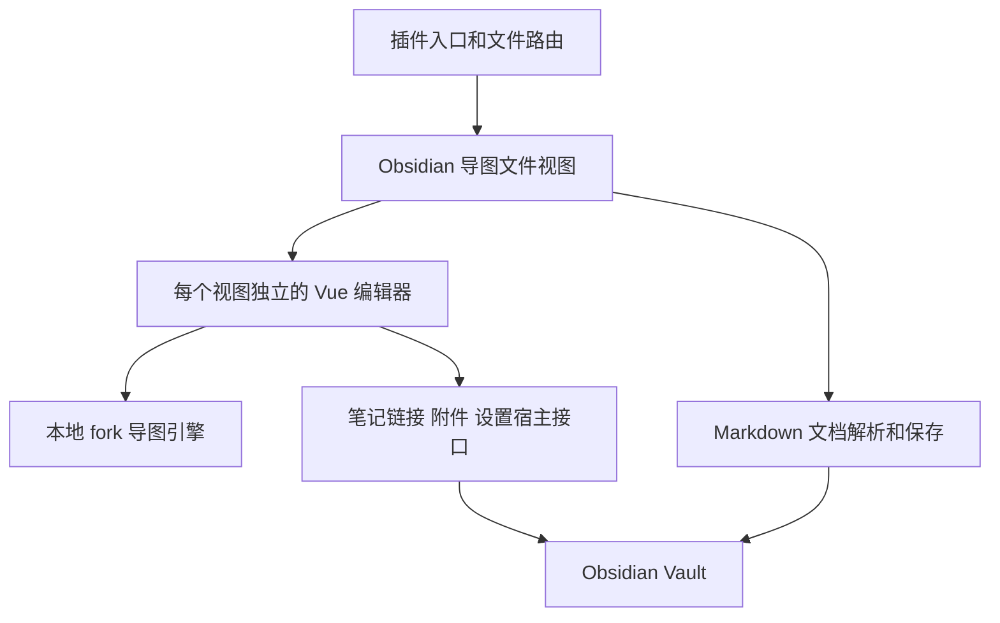

# Obsidian 思维导图插件开发计划

日期：2026 年 10 月 28 日

状态：已进入开发，核心版代码和隔离库构建已完成；正式笔记库尚未安装。当前完成证据见 [核心版验收记录](../plugin/验收记录.md)，使用方法见 [插件说明](../plugin/README.md)。

适用范围：基于当前 fork，为个人使用开发桌面端 Obsidian 思维导图插件。

当前实施采用 JavaScript、原 Vue 组件、独立 Webpack 构建入口和公开工作区事件；没有引入 iframe、新运行依赖或 Obsidian 原型补丁。核心模式先关闭富文本，保留普通文字与字体样式。基础样式中实际使用的额外引擎选项保存在完整数据的 `config` 字段，避免只在当前会话生效。

| 阶段 | 当前状态 |
| --- | --- |
| 阶段零 | 已执行，冻结现有 Webpack 构建、本地引擎别名、公开事件路由，验证环境为 Windows 和 Obsidian 1.14.4 |
| 阶段一 | 已实现，三类必要测试共 7 个用例通过，真机验证冲突拒写、另存副本与末尾文字提交 |
| 阶段二 | 核心界面已接入并做代表性操作和截图验证；高级功能按核心模式裁剪，不声称重新验证上游全部交互 |
| 阶段三 | 已接入导图与 Markdown 切换、独立快捷键范围、笔记选择和跳转，没有原型补丁 |
| 阶段四 | 隔离库可试用，提供构建包和验收记录；正式库安装等待用户指定目标 |
| 阶段五 | 未开始，增强项仍按实际需要单独选择 |

## 一 开发目标和已确认范围

在 Obsidian 内完成独立导图的新建、编辑、保存和笔记链接，尽量保留当前网页应用的工具栏、主题、样式设置与编辑体验。优先参考已安装 Simple mind map 插件的文件视图、宿主接口和生命周期设计，复用 fork 中已有能力，不重写导图引擎，不建设额外服务。

本计划遵循以下已确认要求：

| 编号 | 要求 | 对实现的约束 |
| --- | --- | --- |
| 需一 | 独立导图编辑器 | 不把普通 Markdown 笔记自动转成导图，不做笔记与节点的双向同步 |
| 需二 | 尽量保留现有编辑体验 | 复用 Vue 编辑组件、工具栏、侧栏和样式，不重新设计一套精简界面 |
| 需三 | 参考现有 Obsidian 插件 | 沿用自定义文件视图、Vue 直接挂载、宿主接口、Markdown 外壳的总体做法 |
| 需四 | 首版先做电脑端 | 先在当前 Windows 桌面环境验收；手机后续考虑，macOS 和 Linux 未实测前不声明已验证 |
| 需五 | 导图保存为 Markdown 文件 | 使用自有标记的 `.mindmap.md`，完整导图数据和可读正文共存 |
| 需六 | 不需要读取已有插件导图 | 不兼容、转换或接管现有 `.smm.md`，不读取参考插件用户配置 |
| 需七 | 暂不做 AI 接入 | 不实现模型配置、AI 调用、AI 写回和正文双向同步，也不为这些功能预建接口 |
| 需八 | 减少不必要测试 | 只对可能丢数据的自有逻辑保留少量自动化测试，界面集中手动验收，不设覆盖率指标 |
| 需九 | 个人自用和易维护 | 单进程本地插件，复用现有技术栈，按阶段交付，不扩展成云端产品 |

### 核心功能完成范围

先完成一个可以日常使用的核心版，再恢复有实际需要的高级能力。核心版仍使用原网页的界面结构，不另做一套新界面。下表核心项全部完成才算核心版交付；后续候选不能反过来阻塞这个闭环。

| 功能组 | 首个可用核心版包含的能力 | 不顺带扩展的内容 |
| --- | --- | --- |
| 文件 | 新建、打开、重命名后继续使用、另存副本、导图与 Markdown 视图切换 | 旧插件文件导入、模板市场、文件历史管理 |
| 基础编辑 | 节点增删改、同级和子节点、拖拽、折叠、多选、复制粘贴、撤销重做 | 自研布局算法、实时协作 |
| 外观 | 现有工具栏与侧栏、仓库已有主题和布局、文字和节点样式、连线和背景设置 | 复刻参考插件的付费或闭源新增能力 |
| 节点内容 | 普通文字；已有富文本编辑若无需新增宿主适配则保留，读写时不丢已有节点字段 | 自研富文本工具、复杂节点内容编辑 |
| 导航 | 画布平移缩放、适应画布、已有导图内搜索 | Obsidian 全库搜索结果直接定位节点 |
| 笔记链接 | 选择库内笔记、点击打开、外部网页链接、保留已有标题或区块子路径 | 自动创建目标笔记、全库链接改写、完整反向链接索引增强 |
| 保存 | 自动保存、手动保存、错误提示、外部修改保护、关闭前保存 | 分布式锁、自动合并导图、无限历史版本 |

图标、标签、备注、概要、关联线、外框、大纲、公式、格式刷和小地图属于后续复用清单；现有组件若不增加适配工作可以保留，但显示的入口必须实际可用。图片落库及 PNG、SVG、Markdown 文本导出单列为核心版之后的增强阶段，不是首次可用的前置条件。PDF、XMind、演示模式和更多导入格式按实际需要再决定，不预建全部格式适配。开源库不支持的多根自由节点和概要下继续生长子节点不纳入计划。

## 二 已核实的基础和参考边界

### 当前 fork

基线提交：`e8e5ef9c41bc13ca7b13084e078123adff002242`。开始实现前再次核对，不能覆盖之后的用户改动。

| 事实 | 本地证据 | 对计划的影响 |
| --- | --- | --- |
| 引擎与网页应用已经分开 | [引擎清单](../simple-mind-map/package.json)、[网页清单](../web/package.json) | 引擎继续承担渲染、布局和节点命令；插件负责宿主适配 |
| 网页使用 Vue 2、Vuex、Element UI 和 Vue CLI 4 | `web/package.json`、[网页入口](../web/src/main.js) | 首版不做 Vue 3 或全站构建工具迁移 |
| 网页依赖当前指向 npm 的引擎包 | `web/package.json`、`web/package-lock.json` | 插件构建必须明确指向本地 fork，避免修改的源码没有进入产物 |
| 完整读写接口已有 | [引擎入口](../simple-mind-map/index.js) 的 `getData(true)`、`setFullData()` | 保存节点、布局、主题及视图，不自行拼一个有损节点树 |
| 生命周期接口已有 | 同文件的 `resize()`、`destroy()` | 在 Obsidian 视图中接好尺寸和销毁，不重写引擎生命周期 |
| 网页存在全局状态和事件总线 | `web/src/main.js`、[状态管理](../web/src/store.js) | 调整为每个编辑器实例创建自己的状态和事件总线 |
| 网页存储与宿主尚未分离 | [存储入口](../web/src/api/index.js) | 插件模式改由当前文件提供数据，不能继续用固定 localStorage 键 |
| 主题、布局与节点变化不是同一事件 | `index.js` 的 `view_theme_change`、`layout_change`、`setThemeConfig()` | 保存必须接到所有持久化变更；`setThemeConfig()` 不能假设会触发节点变化事件 |
| 当前开源库不包含全部客户端能力 | [功能说明](../README_MORE_ZH.md) 的“不实现的特性” | 不把闭源客户端的自由节点等能力算入可直接复用范围 |
| 根许可证为 MIT | [许可证](../LICENSE) | 保留原版权和许可文件，单独核对打包依赖的许可和资源归属 |

### 参考插件

参考位置：`C:/Users/86152/Documents/ObsidainProject/CMBK/.obsidian/plugins/simple-mind-map/`。已检查版本为 `0.2.12`；参考主文件 SHA256 为 `a47b54515e981ee04eccaf3651f8214dc91641f502a9eb8a05e2482aab393c62`。

已安装目录只有 `main.js`、`styles.css`、`manifest.json` 和 `data.json`，没有源码工程或 source map。后续以其可核实设计和实际交互作参照，代码实现来自开源 fork 和本项目新增的宿主适配，不把压缩构建包作为维护源码。

| 参考设计 | 本项目采用方式 |
| --- | --- |
| `TextFileView` 内直接挂载 Vue 编辑器 | 采用同一总体结构，首版不使用 iframe |
| `$obsidianAPI` 提供文件、链接、资源和设置能力 | 使用一个小的宿主接口集中实现，组件不各自读取 Obsidian 全局对象 |
| 每个视图创建 Vue 应用、store 和 bus | 保留实例隔离，避免多个导图共享“当前文件”变量 |
| 等待容器有效尺寸、监听激活与窗口变化 | 参考其初始化和尺寸管理顺序 |
| Markdown 中分别保存完整数据、链接和文本 | 采用同一职责划分，首版用未压缩 JSON，省去压缩依赖并方便排错 |
| 修改 `Workspace`、`WorkspaceLeaf` 原型接管打开行为 | 不整套复制；先验证公开事件路由，确实不能满足时再评估最小、可恢复的局部包装 |
| 会员、登录、设备标识、更新检查、AI 服务 | 不纳入自用插件 |

“参考实现存在”只能证明有可借鉴的路线，不能代替新插件在当前 Obsidian 中的验证。

## 三 总体方案和模块划分

### 技术路线

继续使用仓库现有 JavaScript、Vue 2 和导图引擎。宿主提供文件视图和少量 Obsidian 能力，编辑器继续负责导图交互。首版不引入服务器、数据库、跨进程通信或通用插件框架。



### 实现单元

以下是建议的职责和文件位置，不是本轮要创建的空壳。实现时只创建有真实调用点的文件；规模很小时允许合并同一职责内的辅助函数。

| 单元 | 建议位置 | 责任 | 不负责 |
| --- | --- | --- | --- |
| 插件入口 | `plugin/src/main.js` | 注册视图、命令、菜单、设置和卸载清理 | 渲染节点、解析整份文档 |
| 文件路由与视图 | `plugin/src/view/` | 识别本插件文件、切换视图、生命周期、同文件编辑权 | 直接拼接 Markdown |
| 文档格式 | `plugin/src/document/format.js` | 解析和序列化受管区、校验格式、保留非受管内容 | 访问磁盘或修改引擎 |
| 保存协调 | `plugin/src/document/save.js` | 唯一写入入口、串行保存、修订状态、外部冲突 | 自动合并两个节点树 |
| 宿主接口 | `plugin/src/host.js` | 笔记选择与跳转、图片落库、资源路径、设置 | 保存网页全局状态 |
| 编辑器挂载 | `web/src/obsidian/` | 创建独立 store/bus、注入宿主、转发持久化变化、销毁 | 注册 Obsidian 的全局文件事件 |

保留 `simple-mind-map/` 与 `web/` 的原有定位。只修改实际复用路径需要的入口、存储调用、布局和浮层；不为写插件顺带重构所有历史代码。

### 构建约束

1. 优先复用 Vue CLI、Webpack 和现有 Vue 编译依赖，新增插件构建入口，输出 CommonJS 插件与独立样式。阶段零验证能否最小改动达成，不预先承诺某条尚未运行的构建命令。
2. `obsidian` 由宿主提供并设为 external，不能把宿主实现打进插件。所需开发类型或新增构建依赖逐项记录后再采用。
3. 引擎包及 `simple-mind-map/src/...` 深层导入统一解析到仓库内的 `simple-mind-map/`。不能只为主入口设别名，却让深层路径继续来自 npm。
4. 不依赖仓库现有 `dist/`。插件产物输出到独立目录，避免覆盖网页构建和上游已跟踪文件。
5. 不为适配旧构建直接把整机运行环境降级到停止维护的版本；遇到兼容问题先定位到插件构建所需的最小调整。
6. 最终安装包为 `manifest.json`、`main.js`、`styles.css` 和确有引用的资源。字体、图标和图片的路径从插件资源目录解析，不依赖 `localhost`、CDN 或仓库绝对路径。
7. 插件 ID 和视图类型使用独立名称，建议 `personal-mindmap`；不能使用现有插件的 `simple-mind-map` ID。正式显示名称可在打包前调整，不影响文件格式。

### 首版默认行为

界面使用简体中文；新文件默认创建在当前活动笔记所在目录，无有效目录时使用库根目录，默认名为 `未命名导图.mindmap.md`，重名追加序号。默认导图结构为 `logicalStructure`，主题使用 fork 中有效的 `default`，之后记住用户选定的默认项。界面明暗跟随 Obsidian。首版只提供默认目录、默认主题和默认布局等日常确需设置，不把防抖、日志、调试和所有引擎参数都暴露为配置。

## 四 Markdown 文件格式

### 命名和识别

新文件采用 `名称.mindmap.md`。文件内使用独立的 frontmatter 标记 `personal_mindmap: true` 和版本字段 `personal_mindmap_version: 1`，不使用旧插件的文件名或标签标记。

文件后缀用于快速筛选，格式标记与有效数据块用于确认身份。普通 `.md`、旧 `.smm.md`、只有同名标题的笔记，以及未通过格式校验的文件，不能被自动转换或写入。用户重命名去掉约定后缀后，仍可通过明确命令打开带有效标记的文件；不扫描全库补写标记。

### 最小文件示例

下面是格式示意和有效数据样例。受管区边界必须独占一行，解析时要求每类边界恰好一对。

````markdown
---
personal_mindmap: true
personal_mindmap_version: 1
---

<!-- personal-mindmap:data:start -->
```json
{
  "format": "personal-mindmap",
  "version": 1,
  "data": {
    "root": {
      "data": { "text": "中心主题", "uid": "root-1" },
      "children": [
        {
          "data": { "text": "分支主题", "uid": "node-1" },
          "children": []
        }
      ]
    },
    "layout": "logicalStructure",
    "theme": { "template": "default", "config": {} },
    "view": null
  }
}
```
<!-- personal-mindmap:data:end -->

<!-- personal-mindmap:links:start -->
<!-- 此区域由导图生成。 -->
<!-- personal-mindmap:links:end -->

<!-- personal-mindmap:outline:start -->
以下内容由导图生成。编辑这里不会修改导图节点。

- 中心主题
  - 分支主题
<!-- personal-mindmap:outline:end -->

这里可以记录不属于导图节点的个人说明，保存导图时保留。
````

### 数据职责

| 区域 | 作用 | 是否为导图权威数据 |
| --- | --- | --- |
| `data` 受管区 | 保存引擎完整数据，以及本插件格式标识 | 是 |
| `links` 受管区 | 从节点笔记链接生成原生 Markdown 链接，方便普通阅读和链接发现 | 否 |
| `outline` 受管区 | 从节点文字生成可读层级，方便阅读和基本文本检索 | 否 |
| 其他 Markdown 和无关 frontmatter | 用户说明、已有属性和注释 | 不参与节点同步，必须保留 |

首版不生成或嵌入 SVG 预览区，不压缩 JSON，不写入冗余的当前文件路径和每次变化的时间戳。需要图片时由导出命令生成，避免增加预览更新和多份数据同步工作。

完整数据包含引擎实际返回的节点字段、UID、备注、图标、图片、标签、关联信息、布局、主题和视图。外层只做必要的版本和形状校验，不按一份不完整的字段白名单裁剪节点。对于当前版本中不认识的附加数据，未经修改不能静默丢弃。

### 读写规则

1. 读取已存在文件时，空文件、非法 JSON、版本不支持、frontmatter 与数据区版本不一致、边界重复或缺失都进入错误状态，显示原文件与错误原因。不得用示例数据或默认根节点覆盖原文。
2. 创建新文件时才生成默认导图和当前版本格式。文件名冲突使用明确的唯一名称，不覆盖同名笔记。
3. 数据区是唯一权威来源；外部只修改大纲或链接区，不会改变节点。检测到派生区与数据不符时提示，导图保存时才重新生成；不在打开文件时悄悄重写。
4. 保存仅替换三个受管区；无关 Markdown、frontmatter 注释和属性尽量按原始字符串保留，不用一次完整 YAML 重写破坏用户格式。当前版本标记无需在每次保存时重新生成。
5. 序列化固定缩进和区块顺序；不因对象顺序、随机 ID 或视口初始化制造无意义差异。节点 UID 在创建节点时生成，保存时不重新编号。
6. 节点中的 HTML、换行、反引号、类似边界的文字和 Markdown 符号必须作为内容处理，不能让它们提前关闭数据区或伪造受管区。大纲文本使用转义后的纯文本，不原样注入节点 HTML。
7. 格式版本只支持首版定义的版本。未来确有格式变化时再设计迁移；首版不实现通用迁移框架。
8. 不承诺搜索结果定位到节点、完整反向链接或关系图集成。原生链接投影只利用普通 Markdown 行为，不额外构建索引。

## 五 文件打开和视图切换

`.mindmap.md` 的最终扩展名仍是 `md`。不能调用 `registerExtensions(['md'], ...)` 接管全部笔记，也不能假设注册 `mindmap.md` 就能区分复合后缀。

### 打开流程

1. 插件命令或新建操作直接使用 `registerView()` 注册的自有视图类型，并指定目标文件。
2. 文件菜单提供“用思维导图打开”和“用 Markdown 打开”。普通 Markdown 文件不提供隐式转换；格式不符时只提示。
3. 将公开 `file-open` 事件作为候选触发器，用 `onLayoutReady()` 检查已恢复叶片；它们不是所有打开路径必定可用的保证。异步读取标记后，核对目标 leaf 仍显示同一文件、请求仍有效、编辑器内容已经加载且没有未保存缓冲区，再执行切换。阶段零验证前以显式命令作为可靠入口。
4. 每个 leaf 记录用户明确选择的 Markdown 模式，防止用户刚切到源码或阅读模式又被自动切回导图。路由有重入保护，不能递归触发切换。
5. 搜索跳转、历史导航和从链接打开都必须尊重用户选择，不把普通笔记误接管。阶段零集中检查这些路径，不为每种路径建立单独自动化套件。

### 必须提前验证的边界

公开事件能否稳定覆盖自动打开、延迟叶片和工作区恢复，需要在当前 Obsidian 中验证。若不能达到日常使用要求，阶段零给出可复现记录；默认保留显式打开，只在确有日常使用障碍且用户确认后，参考原插件增加最小的 `setViewState` 包装。

如确需包装，只处理本插件文件，保留所有参数、返回值和原始 `this`，尊重用户切换模式，并通过注册的清理函数恢复。不能盲目覆盖其他插件之后安装的包装；无法安全撤销时不得宣称支持热重载。不得复制参考插件全部 `Workspace` 原型补丁。路线在阶段零结束时确定，后续只保留一种有效实现。

### 同一文件的编辑权

首版同一导图只允许一个可编辑导图视图；再次打开时优先定位已有视图。工作区恢复出重复视图时，其他视图只提供定位到已有编辑器的入口，不启动第二套可写引擎。

切到 Markdown 前提交当前节点编辑并保存，再释放导图编辑权。从 Markdown 切回时，先比较目标 `MarkdownView.editor.getValue()` 与 Vault 已读取内容；只在加载完成且内容一致时允许自动切换。若不一致，提示先保存 Markdown；不能丢弃缓冲区后再读取磁盘。若无法通过目标版本的公开接口可靠完成判断，就不自动接管该编辑面，只允许明确的保存后切换。

若同文件还有其他 Markdown 编辑视图，不因它暂时与磁盘一致就允许两边继续编辑；导图暂不进入可写状态，提示关闭另一个编辑面。工作区恢复和插件重新加载时同样执行此检查。磁盘内容比较不能保护仍停留在另一个编辑器缓冲区中的改动。

## 六 保存与外部修改处理

### 单一写入入口

自动保存、手动保存、失活保存、视图切换和正常关闭都经过同一个保存协调器。具体接线为：覆盖 `TextFileView.save(clear?)`，所有请求进入协调器；`getViewData()` 只提供当前文档快照，`setViewData()` 只加载。禁止从其他路径调用基类 `super.save()` 或直接 `vault.modify()` 绕过原文比较。若关闭入口会绕开覆盖的方法，则一并接管该入口，先完成同一保存再清理。阶段零记录目标宿主的实际继承调用顺序，确认这条路线后才进入阶段一。

完整快照从当前引擎获得，不能把 `data_change` 事件携带的纯节点树当成整份文件。获取快照前提交仍在编辑框中的文字或富文本，确保“最后输入后立即关闭”也能保存。

### 最小状态

保存协调器只维护必要状态：基准原文、当前修订号、已保存修订号、进行中的写入，以及 `loading / ready / saving / conflict / error / closing` 状态。不增加通用任务调度或事件溯源系统。

| 场景 | 处理 |
| --- | --- |
| 加载或程序性恢复数据 | 暂停脏标记，加载完成前不允许自动保存 |
| 用户修改节点、主题、布局或样式 | 增加修订号，标记未保存并请求防抖保存 |
| 用户平移缩放 | 保存视口，但不重置内容保存计时；仅视口变化可使用较慢防抖 |
| 已有写入未完成 | 串行处理；期间发生新修改，完成后再保存最新快照 |
| 写入成功 | 更新实际写入的基准原文，只确认本次快照的修订，不能误清之后产生的新修改 |
| 写入失败 | 保留内存数据和未保存标记，显示重试、另存副本等明确操作 |
| 内容未变化 | 不写盘，不产生无意义的修改事件 |

建议初始内容防抖为 800 毫秒，连续编辑最长约 5 秒提交一次；视口防抖约 1500 毫秒。这些只是首版固定值，不增加设置项，实际卡顿或写入频率不合适时再调整。手动保存和正常关闭不等待防抖。

### 变化来源接线

| 来源 | 持久化责任 |
| --- | --- |
| `data_change` | 节点、内容和节点级样式变化，获取完整快照 |
| `view_theme_change` | 编辑器适配层直接监听当前 MindMap 实例，通知宿主标记未保存 |
| `layout_change` | 编辑器适配层直接监听当前 MindMap 实例，通知宿主标记未保存 |
| 全局样式面板调用 `setThemeConfig()` | 操作结束时显式调用当前宿主的变化通知；引擎目前没有对应的统一变化事件 |
| `view_data_change` | 平移缩放和视口信息 |
| 链接、图片、大纲和关联线等复用操作 | 核对是否真正进入上述事件；未进入的调用点补接一次，不靠轮询兜底 |

撤销重做沿用引擎已有历史；不另建第二套撤销栈。主题和布局是否进入引擎历史以实际能力为准，未支持时在界面说明，不能暗示所有设置都能撤销。

### 外部修改

保存前通过 `Vault.process()` 的同步回调比较磁盘当前原文与加载或上次成功保存的基准。相同才写入完整的新文档，不同就中止写入并进入冲突状态。不能只比较修改时间，也不能仅在保存开始之前读一次文件就视为消除了竞争。[Obsidian Vault 文档](https://docs.obsidian.md/Plugins/Vault)

| 外部事件 | 本地无未保存修改 | 本地有未保存修改 |
| --- | --- | --- |
| 修改 | 重新读取并恢复数据，避免触发反向自动保存 | 停止自动写入，保留内存导图，提示冲突 |
| 重命名或移动当前导图 | 更新文件引用、路由和编辑权标识 | 暂停排队写入，重新核对文件身份和基准内容后再继续；不得在旧路径重建 |
| 删除当前导图 | 显示文件已删除并停用保存 | 保留内存快照，提供另存副本；不得自动复活原文件 |
| 本插件自身写入 | 根据本次写入快照精确识别 | 不把期间的新修改当作已经保存 |

冲突处理首版仅提供“重新加载磁盘版本”和“将当前导图另存副本”。重新加载会丢弃内存修改，必须明确提示；另存采用不覆盖的唯一文件名。首版不提供一键强制覆盖外部版本，不做节点自动合并。

自身写入事件按“目标文件对象、进行中或刚完成的序列化原文”识别；先记录待写快照再调用写入，防止 modify 事件早于 Promise 完成。事件本身不携带本插件写入令牌，不能靠时间窗口或一个全局“正在保存”布尔值忽略其他改动。收到事件后必要时读取当前完整原文，相同才按自写处理，不同则走外部变化规则。

重命名或删除事件要使旧目标的排队请求失效；进行中请求完成后再核对目标是否仍存在及当前路径，不能把旧路径字符串重新当成创建请求。受管派生区的外部改动同样参与整份原文比较：本地脏时发生冲突；本地干净时重新加载并按派生区规则提示。

该机制保护本插件通过 Vault API 的读改写，不宣称能锁住其他进程、同步服务或另一台设备。Git 冲突标记和无法解析的数据按损坏文件处理，不自动修复或替换。

### 正常关闭和异常退出

正常关闭按“提交活动编辑框 → 捕获完整快照 → 等待当前写入 → 保存最后快照 → 清理实例”执行。用户主动切换模式或执行可取消的关闭操作遇到保存失败时，保留原视图和快照，提供重试或另存，不能先执行 `clear()` 再取数据。

宿主已强制卸载或关闭无法可靠阻止时，使用已捕获的快照尽力写入唯一恢复副本，并显示实际结果；不能为了假装阻止退出而永久遗留监听和实例。只有副本写入成功才能声称已恢复；同样无法写入时明确报告未落盘风险。此分支是尽力恢复，不是可靠持久化保证。

插件卸载和应用退出回调不保证异步任务必定完成，不能把退出时保存作为唯一保护。依赖日常自动保存，退出处理只做尽力提交。强制结束进程、断电或磁盘故障可能丢失尚未成功写入的时间窗口；首版不建设持续草稿日志或零丢失恢复系统。

## 七 编辑器与 Obsidian 的适配

### 保留界面和替换宿主能力

复用 `web/src/pages/Edit/Index.vue`、`components/Edit.vue` 及实际启用的工具栏和侧栏。保留原有布局关系、控件用途、中文文案和基本操作习惯，只对视图尺寸、宿主文件入口和确实不适用的功能作调整。

| 当前网页行为 | 插件行为 |
| --- | --- |
| 固定 `#app` 挂载 | 挂载到当前文件视图容器，不使用跨视图全局 ID 查询 |
| `Vue.prototype.$bus`、单例 store、模块级“当前数据” | 每次挂载创建实例；使用当前根实例持有的 bus、store 和 host |
| localStorage 保存当前导图 | 当前 Markdown 文件保存导图；插件 `data.json` 仅保存少量通用设置 |
| 浏览器文件树、打开目录和 `showSaveFilePicker` | Obsidian 文件列表、新建命令、保存和另存命令 |
| `document.body` 暗色类 | 界面跟随 Obsidian；不修改宿主 body 的主题类 |
| 全屏固定定位与全局 CSS reset | 以当前视图为定位容器，样式加插件根命名空间 |
| 弹窗和浮层追加到 body | 绑定到当前视图容器，确需顶层弹窗时仍有插件专用类和实例清理 |
| 网页下载客户端提示、统计和示例后端 | 插件入口不包含这些脚本、UI 和请求 |

现有组件中的 `this.$bus` 等调用要统一接到当前根实例；不能依靠“激活时把全局 bus 换成当前 bus”的方式伪造多实例。若共享改动影响仍存在的网页入口，给该真实入口接上同一挂载约定，不保留无人使用的兼容壳。

### 生命周期

1. 容器真实宽高有效后初始化引擎；后台零尺寸标签页先等待，不用默认尺寸硬撑。
2. 用一个 `ResizeObserver` 管理当前容器；激活后处理延迟 resize，隐藏时不连续重建画布。
3. `customInnerElsAppendTo` 指向当前视图内的浮层容器。逐项检查 Quill、Element UI、节点备注和图片工具浮层，不认为设置一个引擎选项就覆盖了所有组件。
4. 激活视图才处理导图快捷键；在普通笔记、输入框和其他标签页操作时不得增删导图节点。不要清空或重新排序 Obsidian 全局快捷键列表。
5. `Ctrl/Cmd+S`、`Tab`、`Enter`、`Delete`、撤销和粘贴分别处理焦点；文字编辑框内的原生编辑行为优先。
6. 销毁时停止计时器和监听、断开 observer、销毁 Vue，并由编辑器生命周期保证引擎 `destroy()` 恰好执行一次。再次清理应安全，不能先清空数据再取保存快照。
7. 首版支持主窗口内标签页和分屏。独立弹出窗口涉及 `ownerDocument/defaultView` 与全局事件所属窗口，阶段零验证前不计入支持范围，未接通时不暴露相关入口。

### 主题与样式

界面明暗跟随 Obsidian；导图文档主题由用户选择并保存。宿主切换深色模式不能悄悄覆盖用户的导图主题。原主题在深色界面下的可读性通过一轮集中检查解决，不新建第二套主题引擎。

全局 Element UI 样式、字体、`.el-dialog`、`*` reset 和高层 `z-index` 是重点适配对象。不能因为主要画布正常就忽略普通 Markdown 编辑器、设置页和其他插件弹窗是否受影响。

## 八 笔记链接和图片

### 笔记链接

使用 Obsidian 的笔记选择能力或简单的候选列表，以当前导图文件为来源解析路径；沿用 `parseLinktext()`、`generateMarkdownLink()` 和 `workspace.openLinkText()` 的实际能力，不自行重写整套链接语法。[官方 API 声明](https://github.com/obsidianmd/obsidian-api/blob/master/obsidian.d.ts)

节点链接保存库内路径和可选子路径。链接选择后保留原有显示文字；点击在新标签页打开目标，避免把正在编辑的导图视图替换掉。中文、空格、同名不同目录和带别名链接需要在同一轮手动流程中覆盖。

外部链接仅在用户点击时打开合法网页地址；拒绝执行 `javascript:` 等脚本链接。找不到目标时提示并保留原链接，不自动创建笔记或改写目标正文。

首版不自动扫描所有导图重写已改名的目标笔记。节点点击优先使用 Obsidian 正常解析；无法解析时允许重新选择目标。`links` 区作为派生投影，不承诺宿主改动该区域后会反向更新 JSON。这个限制须在设置说明中写清，不能把原生 Markdown 链接存在等同于节点链接已完整支持自动重命名。

### 后续增强 图片

核心版之后按需启用本地图片选择和剪贴板粘贴，文件落在库内的统一附件目录，节点只保存库内路径，显示时再转换成资源 URL。不得把 `app://` 临时显示 URL、Windows 绝对路径或 Blob URL 当作持久化地址。

处理顺序为“验证图片 → 生成不重名文件名 → 确认附件写入成功 → 更新节点 → 保存导图”。附件失败不插入失效节点，导图保存失败不自动删除刚写入的附件，防止误删其他真实引用。首版不做自动清理孤立附件。

默认使用 Obsidian 可用的附件位置设置；如果当前宿主能力无法可靠复用，就采用一个清晰的库内专用附件目录并说明，不自行模拟所有附件路径规则。导图移动后，库根相对资源路径仍能显示。已有引擎内嵌图片数据在读写时保留，不在每次保存时隐式迁移。

## 九 最小必要的验证方案

测试的目标是发现自有接线和保存风险，不是证明 Vue、Element UI 或上游导图库本身正确。没有代码变更时不为计划文档运行应用测试。

### 保留的自动化测试

只建设下面三组行为测试，优先使用 Node 自带测试能力；实现前先写能复现目标失败的用例。可以用少量参数化输入合并边界，不按每个字段或按钮拆测试。

| 组别 | 覆盖内容 | 保留原因 |
| --- | --- | --- |
| 自测一 文档往返 | 完整导图读写不丢字段；非受管 Markdown 保留；边界、损坏 JSON、未知版本和特殊文本不会触发默认覆盖 | 保存格式出错可能直接破坏文件 |
| 自测二 保存时序 | 写入期间又编辑、连续请求合并、失败不清脏状态、最终写入最新快照；手动保存与关闭进入同一入口 | 异步时序无法靠偶尔点击可靠发现 |
| 自测三 外部冲突 | 基准内容不一致时拒写；自写事件不误报；删除或改名后不写错路径；同文件编辑权不产生第二写入者 | 防止静默覆盖与旧路径复活 |

不设覆盖率指标，不为所有工具栏按钮写自动化测试，不复制上游测试，不做跨系统和跨主题组合穷举。只有实际改动引擎逻辑或遇到新故障时，才补一个对应的复现测试。

### 一份集中手动验收表

使用隔离测试库和一份有代表性的导图，把相关动作串成以下场景。每个阶段只执行受影响的场景，核心版交付前把已启用核心能力集中验收一次；图片、导出和高级节点功能到增强阶段启用时再验，不提前执行或反复重跑全套。

| 编号 | 场景 | 通过条件 |
| --- | --- | --- |
| 手验一 | 新建 → 编辑 → 自动保存 → 重开 → 重启 Obsidian | 节点、主题、布局、视口和最后输入保留，文件是有效 Markdown |
| 手验二 | 增删、拖拽、折叠、多选、撤销和样式设置；富文本和大纲等仅检查已启用项 | 选中的核心操作有效；未启用入口隐藏，无伪功能 |
| 手验三 | 两张不同导图分屏、切换标签、缩放窗口、打开备注或弹窗 | 数据、快捷键和浮层不串；普通 Markdown 和宿主主题不受污染 |
| 手验四 | 文件树打开、工作区恢复、历史导航、手动切换 Markdown | 只路由本插件文件；用户明确选择 Markdown 后不被抢回 |
| 手验五 | 链接笔记与网页、重新打开和移动导图；启用图片后补一次粘贴与重开 | 核心版链接可用；增强阶段图片可用；目标不存在时数据仍完整 |
| 手验六 | 外部改文件、当前导图重命名或删除、模拟写入失败 | 原文件不被静默覆盖；失败可见；另存或恢复副本可定位 |
| 手验七 | 增强阶段的 PNG、SVG、Markdown 文本导出 | 真实生成可打开的文件，不覆盖原导图；导出失败不影响编辑 |
| 手验八 | 编辑后立即关闭、停用再启用插件、与参考插件同时启用 | 正常关闭数据不丢；没有残留快捷键和浮层；旧导图不被接管 |

性能先复用阶段零记录的同一份中等规模导图，在编辑器接入后对比启动、输入、拖拽和保存。只有出现可感知回退才定位和增加测量，不预设未经测量的节点数量承诺，也不提前建立性能测试平台。

## 十 开发阶段和完成条件

阶段零至阶段四构成核心版闭环，阶段五是之后按需选择的增强工作。阶段结果附实际命令、运行版本、必要截图或用例结果；没有实现和验收证据就不打完成标记。不以某个日期到达替代通过条件。

### 阶段零 冻结构建与宿主接入路线

前置：用户已确认正式开始开发；本阶段已在隔离测试库执行。

工作：

- 记录 Git 状态、Node 与包管理器版本、Obsidian 版本；保留现有用户改动，创建专用测试库。
- 验证现有依赖的安装和构建，确认插件唯一入口和本地引擎来源，不覆盖网页 `dist/`。
- 在测试视图挂载最小编辑器，检查尺寸等待、富文本、浮层与两个不同文件的实例隔离。
- 验证 `.md` 文件打开、Markdown 模式切换、工作区恢复和 `TextFileView` 保存继承路径。
- 核实退出或卸载不能等待异步任务时的实际行为，形成关闭失败的可执行处理顺序。

交付：最小可加载构建、已选定的一条路由方案、实际最低可支持版本依据、必要依赖变更列表。

完成条件：能在测试库加载和移除；普通笔记不受影响；确认后续不需要重写主界面。若直接挂载存在无法解决的全局冲突，先报告复现和最小备选，不自行转成全新 UI 或另一套架构。

### 阶段一 Markdown 文档与安全保存闭环

工作：

- 定义当前版本格式，实现解析、序列化、默认新建和非受管区保留。
- 接入完整快照、活动文本提交、自动保存和手动保存。
- 实现唯一写入入口、修订状态、外部冲突、同文件编辑权和删除保护。
- 完成保存状态提示、损坏文件错误页、另存副本和关闭失败处理。

交付：新建、基础编辑、保存和重新打开可连续使用的最小版本。

完成条件：自测一至自测三通过；手验一和手验六通过；原文件不会因加载错误变成默认导图。这里只建立必要的三个测试组，之后复用。

### 阶段二 保留现有编辑体验

工作：

- 接入原工具栏、主题、结构和样式侧栏，保留现有编辑动作。
- 完成每个编辑器实例独立的状态、事件总线、浮层容器、尺寸和焦点快捷键。
- 接好主题、布局、全局样式与视口保存；去掉插件入口中的网页文件管理与不支持功能。
- 接通已有搜索，核对实际启用的文字编辑方式；大纲和高级节点面板无额外适配即可保留，否则先隐藏并放入增强清单。
- 确认 Vue 与引擎销毁顺序，清理本次改动产生的无用代码。

交付：在 Obsidian 中保留主要网页编辑体验的版本。

完成条件：手验二、手验三通过；只改主题或布局后重开也能恢复；没有未接通按钮。此阶段不为按钮逐个新增测试。

### 阶段三 完成 Markdown 路由和笔记链接

工作：

- 按阶段零确定的唯一路由方案接好新建、文件菜单、文件树和工作区恢复。
- 实现明确的导图与 Markdown 模式切换、重复视图处理和失活行为。
- 实现笔记选择、链接跳转、外部网页和原生链接投影。
- 确保已有 Simple mind map 插件文件和普通笔记保持各自打开方式。

交付：可与日常笔记一起使用的导图版本。

完成条件：手验四通过，手验五的链接部分通过，手验八的共存部分通过；不以拦截所有 `.md` 的方式换取自动打开。

### 阶段四 核心版验收与安装

工作：

- 从独立构建目录生成可重现的安装包，检查资源、许可证、插件 ID 和版本声明。
- 集中执行已启用核心项的手动验收；自动化测试只运行已有三组和新增故障对应的必要用例。
- 打包核心所需图标和字体，清除核心流程对 CDN 和浏览器目录 API 的依赖；关闭网络仍可新建、编辑和保存。
- 检查包中没有统计脚本、默认 AI 网络入口、用户配置、凭证和本机绝对路径。
- 提供安装说明、数据格式说明、已知限制和恢复副本位置说明。
- 经用户指定目标库后安装新 ID 插件；不覆盖参考插件目录或 `data.json`，不自动启用手机支持。

交付：首个自用核心版、安装包、实际验收记录和已知限制。

完成条件：本文“需一”至“需九”和核心功能表逐条闭环；手验七及未启用增强项不计入核心版完成条件。目标库中的新导图正常使用，原有笔记与旧插件文件未被改写。

### 阶段五 按实际需要恢复增强能力

前置：核心版已经交付，用户选择实际需要的增强项；不自动把整个清单都做完。

工作：

- 从图标、标签、备注、概要、关联线、外框、大纲、公式、小地图等已有组件中按需恢复；不为不存在的闭源功能补造通用体系。
- 需要图片时，实现落库、资源路径转换、失败处理和移动后重开。
- 需要输出时，接通 PNG、SVG 和 Markdown 文本导出，只暴露已验证的格式。
- 文本导出作为独立结果，不覆盖当前 `.mindmap.md`；不能宣称文本格式能无损还原全部样式和节点元数据。
- 只补做新增功能对应的集中手动场景；改动涉及持久化时复用已有自动化组，不额外铺设界面测试。

交付：用户选择的增强项、对应安装包和验收结果。

完成条件：所选增强项实际可用；图片相关通过手验五补充部分，输出相关通过手验七；失败不破坏原文件。未选择的增强项不属于遗漏需求，仍保持隐藏或未启用状态。

## 十一 需求与实现及验证对应关系

| 需求 | 实现位置 | 主要调用点 | 验证 |
| --- | --- | --- | --- |
| 独立导图文件 | 文档格式、文件视图 | 新建、打开、保存 | 自测一；手验一 |
| 保留网页编辑体验 | 编辑器挂载和原 Vue 组件 | 工具栏、侧栏、引擎命令 | 手验二 |
| Markdown 和参考设计 | 文件视图、受管数据区、宿主接口 | 解析、快照、视图切换 | 自测一；手验四 |
| 桌面范围 | 插件 manifest 和主窗口生命周期 | 加载、分屏、快捷键 | 手验三、手验八 |
| 核心笔记链接 | 宿主接口 | 选择、跳转、解析 | 手验五的链接部分 |
| 后续图片增强 | 宿主接口 | 粘贴、附件写入、资源解析 | 阶段五启用后补验 |
| 不丢失已确认保存的数据 | 保存协调器 | 所有写入与关闭入口 | 自测二、自测三；手验六 |
| 后续输出增强 | 已启用的导出组件和宿主输出 | 导出命令 | 阶段五启用后执行手验七 |
| 原插件共存和不做旧格式兼容 | 自有 ID、标记、路由 | 文件识别、加载和卸载 | 手验八 |
| 不做 AI 和减少测试 | 插件入口依赖与验证清单 | 构建、检查启用功能 | 无 AI 服务初始化；仅保留三组必要测试 |

编码交付时将“建议位置”替换或补充为实际文件和调用点。新定义的接口必须有真实调用；不以计划里列过某项作为已经接线的证据。

## 十二 风险和处理优先级

| 风险 | 优先级 | 处理或接受边界 |
| --- | --- | --- |
| Markdown 和导图两个编辑面互相覆盖 | 必须先解决 | 单文件一个编辑权，切换先保存；不自动双向同步 |
| 外部同步、删除或改名期间写错内容或路径 | 必须先解决 | 原文比较、串行写入、文件对象更新和冲突另存 |
| 主题或样式只在界面变化，文件没有保存 | 必须先解决 | 明确列出持久化变化来源并检查真实调用 |
| 自动路由抢占普通 Markdown 或反复切换 | 必须先解决 | 自有标记、leaf 状态校验、模式记录和阶段零验证 |
| 依赖仍从 npm 引擎构建 | 必须先解决 | 所有主入口和深层路径统一解析到本地 fork |
| 全局 CSS、快捷键、富文本影响其他标签 | 必须先解决 | 实例状态、容器样式、活动焦点与完整清理 |
| 旧构建依赖与当前运行环境不兼容 | 阶段零处理 | 只调整插件所需路径，记录依赖变化，不全站重写 |
| 目标笔记重命名后节点链接失效 | 首版限制 | 不承诺自动改写；使用正常解析和手动重选 |
| 插件停用或异常结束时尚有未写数据 | 首版限制 | 日常自动保存、正常关闭提交、尽力恢复；不承诺断电零丢失 |
| 附件路径、资源或导出依赖外网 | 交付前解决 | 本地资源、库内路径和离线核心流程检查 |
| 参考插件的闭源能力在 fork 中不存在 | 范围约束 | 只以开源真源确认可复用功能，不承诺全部产品功能对齐 |
| macOS、Linux、手机和独立窗口未经验证 | 支持边界 | 不把未测平台写入已验证列表，按实际需要单独推进 |

## 十三 变更纪律和最终交付

开发只在当前 fork 内进行；参考插件目录和用户笔记库在测试阶段保持只读。真实库安装单独指定目标，先保留原插件和数据。测试库只使用虚构内容，不复制整库或凭证。

依赖新增、构建路线或宿主原型包装等重大变化，先提供具体依据和范围，再与用户确定；不因实现困难默默扩大架构。没有必要时不新增抽象、配置和功能。

每阶段保持可运行，按逻辑变更审查差异。暂存时精确列出文件，不提交构建产物、日志、测试库或用户设置。没有明确发布请求不推送。任何提交操作按会话授权和仓库约定执行，不为交付文档自动初始化仓库。

最终交付必须包含：

- 可安装的插件包和对应源码。
- 核心功能表逐项完成记录；未完成项明确列出，不能用“基本可用”代替。
- 一份仅覆盖已启用能力的集中手动验收记录，以及三组必要自动化测试结果。
- Markdown 文件格式、节点链接限制、安装与卸载说明。
- 写入失败和恢复副本的实际操作方法。
- 已验证平台、Obsidian 版本，以及尚未解决的限制。

项目若采用 `STATUS.md`，由主代理统一更新；当前仓库未发现该文件或既有使用约定，本轮不额外创建状态文件。本文保留为实施对照，阶段完成后按证据更新状态，不另建重复计划。

## 十四 外部依据和实施前检查

- [Obsidian 官方 API 声明](https://github.com/obsidianmd/obsidian-api/blob/master/obsidian.d.ts)：文件视图、视图注册、工作区、链接和 Vault 事件。实现时核对目标最低版本，不能把当前 master 的全部能力当成最低版本已有。
- [Obsidian Vault 文档](https://docs.obsidian.md/Plugins/Vault)：读写、`process()` 与外部修改时的内容比较；它不提供跨设备事务或本插件的冲突 UI。
- [Obsidian 官方示例构建](https://github.com/obsidianmd/obsidian-sample-plugin/blob/master/esbuild.config.mjs)：参考宿主依赖 external 与 CommonJS 输出约定，不据此强制迁移现有 Vue 构建。
- 本地参考插件 `0.2.12` 的 `TextFileView`、`$obsidianAPI`、文档序列化与生命周期调用；参考文件为已安装构建产物，静态分析不能代替新实现的实际运行。

实施前检查只保留四项：确认计划范围、Git 工作区状态、隔离测试库、阶段零验证环境。其他决定按相应阶段处理，不在计划完成后提前安装依赖或修改生产插件。
